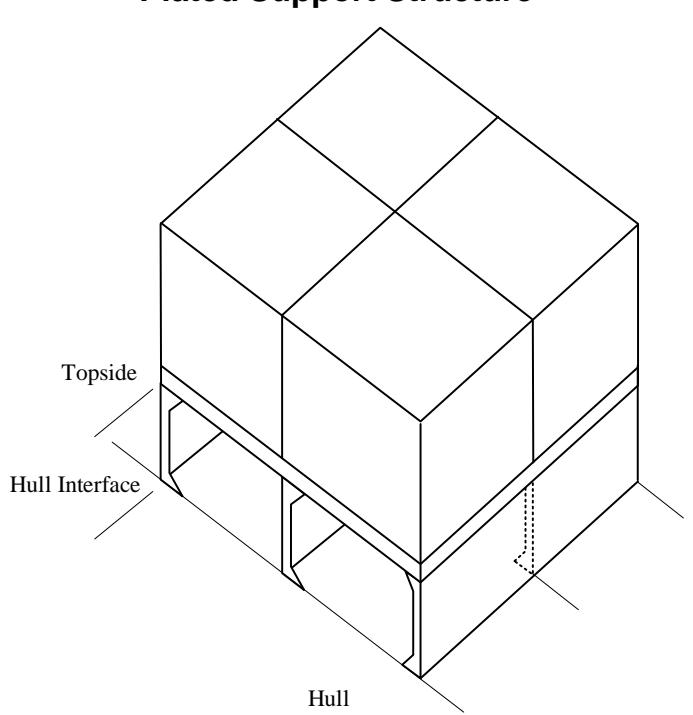
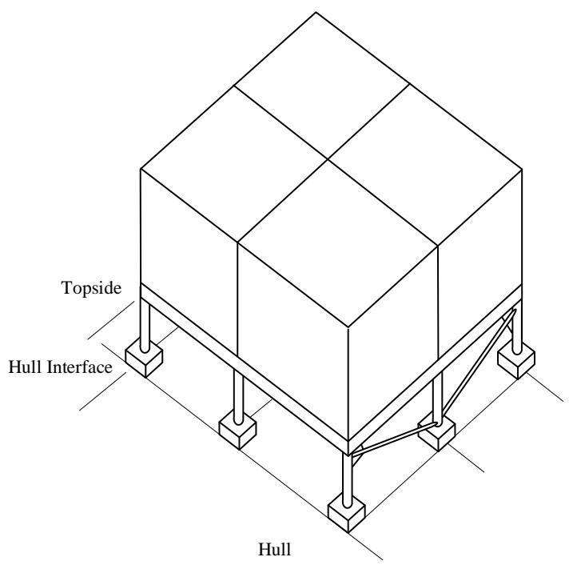
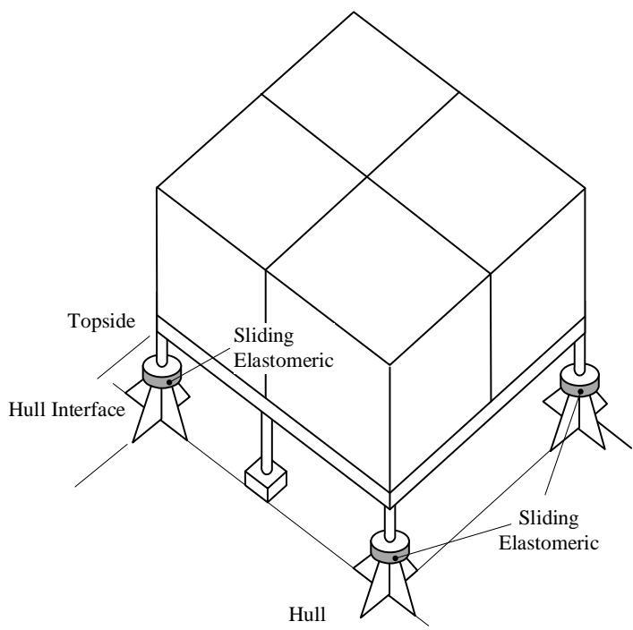
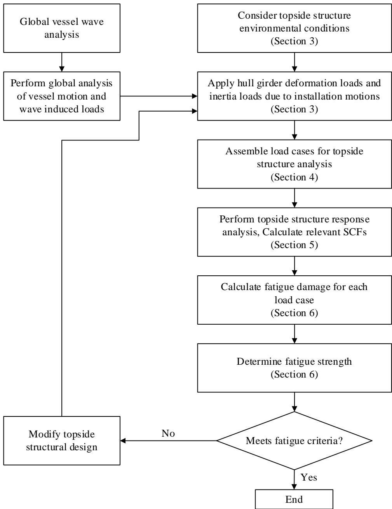
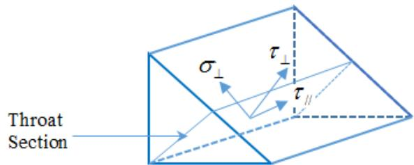

GUIDANCE NOTES ON

# TOPSIDE STRUCTURE FATIGUE ASSESSMENT FOR SHIP-TYPE FLOATING PRODUCTION INSTALLATIONS

MARCH 2016

American Bureau of Shipping

Incorporated by Act of Legislature of

the State of New York 1862

Copyright  2016

American Bureau of Shipping

ABS Plaza

16855 Northchase Drive

Houston, TX 77060 USA

## Foreword

The purpose of these Guidance Notes is to supplement the topside structure fatigue assessment of ship-type floating production installations in accordance with the ABS Rules for Building and Classing Floating Production Installations (FPI Rules). These Guidance Notes provide recommended procedures for performing fatigue assessment of topside structures. Guidance Notes are not mandatory requirements.

These Guidance Notes become effective on the first day of the month of publication.

Users are advised to check periodically on the ABS website www.eagle.org to verify that this version of these Guidance Notes is the most current.

We welcome your feedback. Comments or suggestions can be sent electronically by email to rsd@eagle.org.

GUIDANCE NOTES ON

## TOPSIDE STRUCTURE FATIGUE ASSESSMENT FOR SHIP-TYPE FLOATING PRODUCTION INSTALLATIONS

## CONTENTS

SECTION 1 Introduction....1
1 General....1
3 Features....1
5 Application....2

SECTION 2 Topside Structures....3
1 General....3
3 Topside Design Principles....3
3.1 Hull Interface Structures....3
3.3 Fatigue Assessment Procedures....5

FIGURE 1 Plated Support Structure....4
FIGURE 2 Portal Frame Structure....4
FIGURE 3 Sliding Support Structure....5
FIGURE 4 Schematic Representation of Topside Structure Fatigue Analysis Procedure....6

SECTION 3 Loads....7
1 General....7
3 Operating Weights....7
5 Hull Girder Deformation Loads....7
7 Inertia Loads due to Unit Motions....7
9 Wind Loads....7
11 Live Loads....8

SECTION 4 Loading Conditions for Topside Structural Fatigue Analysis....9
1 General....9
3 Design Operational Loading Condition....9
5 Transit Conditions....9
7 Loading/Offloading Condition....10

SECTION 5 Structural Modeling and Analysis....11
1 General....11
3 Areas for Fatigue Strength Assessment....11
5 Structural Modeling....11

SECTION 6 Fatigue Damage Calculation and Acceptance Criteria....13
1 General....13
3 Methodology....13
3.1 Simplified Fatigue Method....13
3.3 Spectral-Based Fatigue Method....14
3.5 Time Domain Analysis Method....14
5 S-N Data....14
7 Nominal Stress Approach and Stress Concentration Factor (SCF) .15
9 Hot Spot Stress Determination....15
11 Acceptance Criteria....16

FIGURE 1 Illustration of Stresses on the Throat Section of a Fillet Weld....15

APPENDIX 1 References....17

# S E C T I O N 1 Introduction

## 1 General

The ABS Rules for Building and Classing Floating Production Installations (FPI Rules) require strength and fatigue assessment of the topside module/hull interface on the ship-type installations. The hull interface structure specified in the ABS FPI Rules is the interface structure between the main hull and topside structures, including associated stools and elastomeric bearings, as fitted. Topside modules are the discrete structural units that support production facilities and supporting systems, and fatigue analysis of these structures is not required by the FPI Rules.

For ship-type floating production installations such as FPSOs, topside modules installed on deck of an installation may include but are not limited to oil/gas processing modules, gas compression modules, power generation modules, flare tower, vent stack, helideck, pipe rack, and laydown areas. Newer generations of topside structures are large in size and heavy in weight. They are important parts of the installation structures that are critical to the operation and structural integrity of ship-type installations. Thus there may be a need to perform the fatigue assessment in addition to strength evaluation of the topside structures.

As a supplement to the fatigue assessment of the topside interfaces on ship-type installations, these Guidance Notes provide the recommended procedures for performing fatigue assessment of the topside structures on ship-type installations. In general, Guidance Notes are not mandatory requirements.

Note that Installation, Ship-type installation or Unit, as used in these Guidance Notes, refers to ship-type floating production installation.

## 3 Features

The topside structure fatigue assessment involves the evaluation of the following areas:

Environment wave conditions

Metocean data, sea state scatter diagram

• Design load conditions

• Finite element model local boundary conditions

• Structural geometry

• Structural stress range and stress concentration factor

• Fatigue analysis methodology

• Accumulated fatigue damage, fatigue acceptance criteria and design fatigue life

The primary features of these Guidance Notes include:

• Design principle of hull interface structure and topside structures

• Design loads for fatigue strength assessment

• Loading conditions for topside structure fatigue analysis

• Accumulated fatigue damage prediction

• Fatigue acceptance criteria for topside structures

## 5 Application

These Guidance Notes describe procedures to perform fatigue assessments of topside structures on shiptype floating production installations. The procedures can be used for

• Topside structure fatigue life prediction.

• Assistance in topside structure design and survey.

These Guidance Notes should be used in association with ABS Rules and Guides for fatigue assessment, such as the ABS Guide for the Fatigue Assessment of Offshore Structures and the ABS Rules for Building and Classing Floating Production Installations (FPI Rules).

## SECTION 2 Topside Structures

## 1 General

Topside structures are the modular structures including all types of equipment above the main deck, typically the processing modules on ship-type installations. The topside structures and the interface structures are designed to carry the weight of the equipment and topside structures, and to have structural adequacy for the inertia loads induced by the wave loads and the flexibility to minimize the stresses induced by the hull girder deformation in design environmental conditions and sea states. The stress distribution in the topside structure is governed by the structural design of the topside, local loads and ship-type installation’s accelerations and deformations.

The design and analysis criteria to be applied to the topside structures and hull interface structures are specified in the FPI Rules. The structural strength design of the hull and hull interface structures on shiptype installations is to be in accordance with 5A-1-3/1 and Sections 5A-1-4 and 5A-3-2 of the FPI Rules, regarding how load components can be adjusted.

A detailed fatigue assessment may be performed for topside structures combined with hull interface structures. Rational fatigue analysis methods are acceptable if the forces and member stresses can be properly represented. The dynamic effects should be taken into consideration if they are significant to the structural response. For the frame members of the topside structures, the S-N curves specified in the ABS Guide for Fatigue Assessment of Offshore Structures and API RP 2A (WSD -21st or later Edition) are recommended. The stress concentration factors (SCFs) for unstiffened tubular joints may be calculated based on applicable empirical formulas with validity limitations. The SCFs should capture the geometrical discontinuities inherent to the design as well as the effect of fabrication tolerances, when deemed necessary (e.g. mismatch between abutting plates). In this regard, for complex critical connections, the hot spot stress approach should be used in line with the mesh recommendations defined in ABS Guide for the Fatigue Assessment of Offshore Structures.

## 3 Topside Design Principles

## 3.1 Hull Interface Structures

The various functions of the topside modules give rise to many disciplines in the topside design. The hull interface structures, which transmit loads between the main hull structure and topside structure, have impact on fatigue capacities of topside structures. Based on various deck stool design types, three typical designs of hull interface structures are illustrated.

## 3.1.1 Plated Support Structure

The connection between the deck and the stool or gusset is assumed to be welded. The actual connection design to the deck is typically comprised of welding along transverse frames and longitudinal stiffeners. Section 2, Figure 1 shows the typical hull welded connection in the longitudinal direction and shear plates in the transverse direction. The plated support structure, shear panels, decks including the hull backup structures and the reinforcements for the hull due to the transferred acceleration loads are to be designed in accordance with the FPI Rules. Fatigue calculations are to be performed for all vital components.

FIGURE 1 Plated Support Structure  

## 3.1.2 Portal Frame Support Structure

In a portal frame design, the main girder/column joints are assumed to be welded on the longitudinal bulkheads or large longitudinal deck stringer underneath the girder/column in addition to a web frame. An example of a portal frame structure is shown in Section 2, Figure 2. The deck plating inserts and under deck reinforcement may be required for the frame bending moment.

FIGURE 2 Portal Frame Structure  

## 3.1.3 Sliding or Elastomeric Bearing Support Structure

The sliding connection design provides the bearing supports for the topside structure except the locations that are fixed to the deck. This reduces the effect of the topside module supporting structure on the hull girder by allowing movement when the connection friction is overcome by the horizontal force. The uplift forces and friction forces on the bearings thus create the complication in the design and fabrication. Including the friction forces in the fatigue analysis may be difficult due to the non-linear behavior. The sliding connections evaluated with an all fixed analysis model might be conservative for the main deck longitudinals. If an all fixed connection analysis produces unrealistic stresses in the main deck longitudinals, an advanced iterative analysis procedure should be employed to evaluate of the sliding connections. [6]

The elastomeric bearing/pads design provides the supports of topside structures with no sliding effect but large deformations of the pads in shear. The large deformation of the elastomeric bearings may reduce the force transfer of the hull girder deformation loads to the topside structures. The non-constant stiffness of the elastomeric pads may be employed to evaluate the loads transferring between the elastomeric bearings and topside structures. A sketch of sliding or elastomeric bearing supports is shown in Section 2, Figure 3.

The sliding or elastomeric bearing support structure and decks including the hull interface structures are to be designed in accordance with the FPI Rules. The effect of loads transferred through the sliding connections or elastomeric bearings onto the topside structures should be included in the topside structure fatigue analysis.

FIGURE 3 Sliding Support Structure  

## 3.3 Fatigue Assessment Procedures

The procedure for topside support structure fatigue assessment in these Guidance Notes includes the following components:

• Identify the hull girder deformation loads and inertial loads due to the vessel motion and wave induced loads.

• Establish the topside environmental conditions.

• Assemble load cases for topside structure fatigue analysis.

• Perform topside structure response analysis.

• Calculate SCFs with a local model or refined mesh in the global model if nominal stress method applied.

Calculate fatigue damage for each load case.

• Calculate combined fatigue damage and determine the fatigue strength.

• If fatigue criteria are not met, modify the topside structural design and repeat the above analyses.

The schematic representation of the topside structure fatigue analysis procedures is shown in Section 2, Figure 4.

FIGURE 4  
Schematic Representation of Topside Structure Fatigue Analysis Procedure  

# SECTION 3 Loads

## 1 General

Loads for the topside structure fatigue analysis relate to the probable variations that the hull structures and the topside modules will experience during its on-site operation and in transit and installation process. The major loads considered in the analysis of topside structures on the ship-type installation are operating weights, hull girder deformation loads, inertia loads due to unit motions, wind loads and live loads.

## 3 Operating Weights

Operating weights in topside structures consist of self-weight of structural members such as columns, beams, plates, grating, etc., and static weight of the equipment, piping, electrical, instrumentation, and miscellaneous members. Dry weights of structural members and equipment, piping, etc., are considered in the transit loading conditions. Wet weights, that is, the dry weight plus fluid weights in the equipment, piping and instrumentation are considered in design environmental and operating conditions.

## 5 Hull Girder Deformation Loads

Topside structures may be subject to the hull girder deformations of the ship-type installation as a result of still water bending and wave induced bending moments. In addition, the local mass distribution of the topside modules also affects the deck structure locally from static and dynamic loads. Due to the strength of the topside supporting structure, the hull girder loads introduce forces into the topside structure which in turn produce forces back to the vessel deck locally via the columns that connect the topside structure to the vessel’s top deck. In such cases, the effects of the hull deformation induced loadings on the topside structure should be included in the analysis. If the topside structures are supported by sliding or elastomeric bearing support structures, the component of hull girder deformation loads may be reduced but the vertical hull girder deformation loads should be included.

When tank/hull designs account for thermal cyclic fatigue, the hull deformation induced by the temperature changes during tank loading /unloading cycles, large temperature gradient from adjacent tanks, and the operational/environmental temperature changes which can cause relative hull deformations, should be considered.

The process of loading and offloading (e.g., ballasting/deballasting) can result in uneven buoyancy for the installations. The hull deformation induced by this loading/offloading process may be considered in the low cycle fatigue analysis.

## 7 Inertia Loads due to Unit Motions

The ship-type installations are subjected to wave induced motions during their transit and operations in various environments. Inertia loads of topside structures are determined by the mass distribution of the topside structures and the accelerations induced by the installation’s motions.

## 9 Wind Loads

For individual tubular structural components in the wind-sensitive topside structure an assessment of the possibility of vortex-induced vibrations due to wind on exposed structural components should be undertaken. Fatigue damage due to vortex-induced vibrations on lattice structures (e.g., flare booms and drilling derricks) and exposed pipework may be considered.

## 11 Live Loads

Loads on the topside structures, representing operating personnel, trolleys and temporary storage etc., are applied as uniform or concentrated loads on the topside deck structure. In accordance with the FPI Rules, the following loadings should be considered as minimums:

• Crew spaces (walkways, general traffic area, etc.)

$$
4 5 1 0 \mathrm{N} / \mathrm{m} ^ {2} (4 6 0 \mathrm{kgf} / \mathrm{m} ^ {2}, 9 4 \mathrm{lbf} / \mathrm{ft} ^ {2}) \text {or} 0. 6 4 \mathrm{m} (2. 1 \mathrm{ft}) \text {head}
$$

• Work areas

9020 N/m2 (920 kgf/m2, 188 lbf/ft2) or 1.28 m (4.2 ft) head

• Storage areas

13000 N/m2 (1325 kgf/m2, 272 lbf/ft2) or 1.84 m (6.0 ft) head

• Laydown areas

$$
9 8 1 0 \mathrm{N} / \mathrm{m} ^ {2} (1 0 0 0 \mathrm{kgf} / \mathrm{m} ^ {2}, 2 0 5 \mathrm{lbf} / \mathrm{ft} ^ {2}) \text {or} 1. 3 9 \mathrm{m} (4. 5 6 \mathrm{ft}) \text {head}
$$

Alternatively, the above variable loads may be adjusted depending on the analysis type (global or local structures) and facilities, based on the recognized industry standards, such as API, ISO, and NORSOK standards, etc. If the facilities, equipment and storage, etc., variable loads have been modeled in the analysis models, or the masses not on a nearly permanent basis, the above applied live loads may not be considered for topside fatigue analysis except the laydown areas. For laydown areas, large masses are usually latched there on a nearly permanent basis, the live loads should be included in the fatigue analysis.

These loads combined with dead loads and installation’s accelerations induced by the installation’s motions should be included in the topside structure analysis.

# SECTION 4 Loading Conditions for Topside Structural Fatigue Analysis

## 1 General

Loading conditions which produce the most unfavorable effects on the topside structures for the transit and operation conditions should be considered. The environmental conditions and applicable loads described in Section 3 should be used to establish the design load cases for these conditions.

The responses of topside structures are related to the ship-type installation’s motions. Installation’s response may differ significantly in different loading conditions. It is therefore of importance to include response for actual loading conditions. Since fatigue is a result of numerous cyclic loads, only the most frequent loading conditions are included in the fatigue analysis. There normally are intermediate, full storage, after offloading conditions, and significant variations in topside equipment loads.

The fraction of cumulative fatigue damage in the full storage conditions, in intermediate condition and after offloading conditions as well as variations in topside equipment loads may be taken according to 5A-3-A2/5.7 of the FPI Rules.

## 3 Design Operational Loading Condition

The site-specific environmental conditions, including both 100-year return period environmental events and wave scatter diagram data of wave height/period joint occurrence distribution, should be considered for the structural strength and fatigue assessment. Detailed fatigue design loading conditions are specified in Section 3-2-3 of the FPI Rules.

Generally, fatigue damage due to wind gust and dynamic effects may not be considered for topside fatigue analysis. However, for flares, vent stacks and helideck framing, etc., slender structures, the vortex induced vibrations (VIV) and fatigue damage by the VIV may be included in the analysis.

Vibration induced cyclic loading from the operation of topside rotating/reciprocating equipment may be considered in the assessment of topside fatigue. Where cyclic frequency of the topside rotating/reciprocating equipment is close to the modal frequencies of the topsides then appropriate dynamic analysis should be performed.

## 5 Transit Conditions

The wind and wave conditions representing the environment for the transit route from the building or outfitting site (or the shipyard where the conversion modifications are made) to the project site and the time of the year should be determined for the design of a ship-type installation. All transit conditions occurring during the operational life of the ship-type installation should be included. The accumulated fatigue damage during transit voyages and at operating sites should be included in the overall fatigue damage assessment for the integrated topside deck structures.

For transit (topside production facility in dry condition), it is the shipyard’s and designer’s responsibility to specify the design parameters for the transit condition.

During assessment of the fatigue damage accumulated during transit cases, the installation loading pattern and draft for voyage from outfitting yard to the installation site are to be considered, the effects of vessel speed may be included in the evaluation of number of stress cycles.

## 7 Loading/Offloading Condition

Fatigue strength assessment of topside structures may include the effects of on-site operational loading and unloading cycles of produced substances, equipment and piping, etc. If the topside structural components experience local cyclic plasticity when the loading/unloading produces cyclic stresses that exceed the yield strength of the material, the low cycle fatigue damage should be considered. The calculation of low cycle fatigue damage is specified in 5A-3-A2/17 of the FPI Rules.

# SECTION 5 Structural Modeling and Analysis

## 1 General

The structural adequacy of the topside structures should be examined by the Finite Element Method (FEM) using a three dimensional (3-D) model. The hull girder deformation loads and inertia loads due to unit accelerations may obtain from the pre-determined global model analyses, for example, dynamic loading approach for full model analysis and/or ship-type installation total strength assessment.

To evaluate the fatigue strength of local structure, the FE analysis of fine mesh local models or local refined mesh in the global model should be performed. In the fine mesh local models, care should be taken to accurately represent the structure’s stiffness, as well as its geometry. Boundary displacements or forces obtained from the overall 3-D analysis model should be used as boundary conditions in the fine mesh analysis of local structures. In addition to the boundary constraints, the pertinent local loads should be reapplied to the fine mesh models.

Specialized fine mesh FE analysis is required in the determination of stress concentration factors associated with the “hot-spot” fatigue strength evaluation procedures (see Subsection 6/4).

## 3 Areas for Fatigue Strength Assessment

General guidance on the critical areas of the ship-type installation hull and interface structures where fatigue assessment should be performed is specified in the FPI Rules and the ABS Guide for Spectral-Based Fatigue Analysis for Floating Production, Storage and Offloading (FPSO) Installations.

Additionally, the fatigue strength of the following critical topside structure areas should be assessed:

• Joint connections between support frames and column structures

• Connections of the pancake plates and support columns

• Interface details of equipment support structures and foundations with the weight of equipment greater than 20 tons

• Additional areas, highly stressed by fluctuating loads, as identified from structural analysis

## 5 Structural Modeling

The 3-D FE structural and load modeling should be as detailed and complete as practicable. In making the FE model, a judicious selection of nodes, elements and degrees of freedom should be made to represent the stiffness and mass properties of the hull, while keeping the size of the model and required data generation within manageable limits. Lumping of plating stiffeners, use of equivalent plate thickness and other techniques may be used for this purpose. The finite elements, whose geometry, configuration and stiffness closely approximate the actual structure, can typically be of these types: 1) beam elements with axial, shear and bending stiffness, and 2) membrane and bending plate elements, either triangular or quadrilateral, however the triangular elements should be avoided in fatigue sensitive areas and hot spot stress areas.

The models are to be constructed with linear quadrilateral and triangular elements (shell elements being flat bending plate elements arranged in the mid-plane of the structural components) and one-dimensiona rod and beam elements. The areas around the expected stress concentrations in each model (e.g., bracket heel, bracket toe, etc.) are to be carefully meshed with quadrilateral shell elements of approximate size t × t, where t is the minimum plate thickness in the vicinity of a particular stress concentration.

The welds are usually not modeled except for special cases where the results are affected by high local bending (e.g., due to an offset between plates, such as doubling, or due to a small free plate length between adjacent welds such as at lug (or collar) plates, etc.). In this case, the weld may be included by vertical or inclined plate elements having appropriate stiffness or by introducing multiple constrained elements to couple node displacements.

The connection to the hull interface structures should be modeled in sufficient detail to such that simplifications of the boundary conditions for the support structures do not influence the topsides behavior.

More details of FE modeling can be found in 5A-3-A4/9 and 5A-3-A4/11 of FPI Rules.

# SECTION 6 Fatigue Damage Calculation and Acceptance Criteria

## 1 General

These Guidance Notes provide guidance for the fatigue analysis of topside structures on the ship-type installation. To verify the fatigue strength of the topside structures for their intended design fatigue life, a detailed fatigue analysis should be carried out for each individual structural detail that is subjected to extensive cyclic loading. The welded joint and attachment or other form of stress concentration may be subject to potential risk of fatigue cracking and should be individually considered.

The strength of a structural detail to resist fatigue damage is characterized by the use of S-N Data, which are described in Sections 2 and 3 of the ABS Guide for the Fatigue Assessment of Offshore Structures. Using the S-N approach, fatigue strength (capacity) is usually characterized in one of two ways. One way is called a nominal stress approach. In this approach, the acting cyclic stress (demand) is considered to be obtained adequately from the nominal stress distribution in the area surrounding the particular location for which the fatigue life is being evaluated. The other way of characterizing fatigue strength (capacity) at a location is the “hot-spot” approach. The hot-spot approach is needed for locations where complicated geometry or relatively steep local stress gradients would make the use of the nominal stress approach inappropriate or questionable.

These Guidance Notes give an overview of the necessary analysis to be performed such that fatigue strength of the topside structures can be documented satisfactorily. A more detailed reference for the fatigue analysis approaches should refer to the ABS Guide for the Fatigue Assessment of Offshore Structures and the FPI Rules.

## 3 Methodology

Fatigue assessment denotes a process where the fatigue demand on a structural element (e.g., a connection detail) is established and compared to the predicted fatigue strength of that element. The fatigue damage is calculated assuming that the linear summation of the individual damage from all the considered stress range intervals, that is, the cumulative fatigue damage (the Palmgren-Miner Rule) is applicable. The following methods of fatigue calculations are referred to in the ABS Guide for the Fatigue Assessment of Offshore Structures:

• Simplified fatigue method

• Spectral-based fatigue assessment method

• Time domain analysis method

## 3.1 Simplified Fatigue Method

The simplified fatigue method is based on the assumption that the long term distribution of stresses can be described by the maximum dynamic stress amplitude and a Weibull shape parameter. The method is described in ABS Guide for the Fatigue Assessment of Offshore Structures. For FPSO vessels, one way to determine the loads and long term statistics (Weibull parameter and number of load cycles) may be by means of direct load calculations based on the site specific scatter diagram, refer to the ABS Guide for ‘Dynamic Loading Approach’ for Floating Production, Storage and Offloading (FPSO) Installations. Another alternate method to obtain the fatigue inducing loads and determine the total stress ranges is the FPI Rules defined loads and calculation of fatigue damage for the Ship-Type Installations. Detailed loads definition and calculations refer to Appendix 5A-3-A2 of the FPI Rules.

Where the information about the load cycles and their coincidence is not available, fatigue calculation may be based on the “worst case” by combination of maximum stress for each component.

## 3.3 Spectral-Based Fatigue Method

Spectral-based fatigue analysis is a complex and numerically intensive technique where all loads from global and local loads are included by use of finite element models and direct transfer of loads from the hydrodynamic analysis to the structural model in equilibrium. All stress components are combined using the correct phasing and without simplifications or omission of any stress components. However, there are basic minimum assumptions that are to be the basis of the method employed and some of the key details that are to be incorporated in the method to produce results that will be acceptable to ABS.

The main assumptions underlying the Spectral-based Fatigue Analysis method are listed below:

i) Ocean waves are the main source of the fatigue-inducing loads acting on the structural system being analyzed. The fatigue damage from other loading sources can be considered separately.

ii) In order for the frequency domain formulation and the associated probabilistically-based analysis to be valid, load analysis and the associated structural analysis are assumed to be linear. Hence, scaling and superposition of stress transfer functions from unit amplitude waves are considered valid.

iii) Nonlinearities, brought about by nonlinear roll motions and intermittent application of loads such as wetting of the side shell in the splash zone, are treated by correction factors.

iv) Structural dynamic amplification, transient loads and effects such as springing are insignificant for a typical FPSO hull structure, and hence, use of quasi-static finite element analysis is valid, and the fatigue inducing stress variations due to these types of load effects can be ignored.

Also, it is assumed that the short-term stress variation in a given sea-state is a random narrow-banded stationary process. Therefore, the short-term distribution of stress range can be represented by a Rayleigh distribution.

Detailed implementation of the spectral-based fatigue method refers to the ABS Guide for the Fatigue Assessment of Offshore Structures and the ABS Guide for Spectral-Based Fatigue Analysis for Floating Production, Storage and Offloading (FPSO) Installations

## 3.5 Time Domain Analysis Method

Due to the limitations of the spectral method (e.g., linear and hard to predict low-frequency fatigue stresses), the Time-Domain Method along with its associated rainflow counting technique can be employed in the fatigue assessment of topside structures on the ship-type installations. In the time-domain approach, the long-term wave condition is discretized into representative sea-states of short duration and constant intensity. A time history of the wave kinematics for the short duration is generated from the wave spectrum. Hydrodynamic loads are then calculated based on the wave kinematics and applied to the structural model. In addition, wind loads with a suitable wind spectrum can also be applied to the structural model. Nonlinear effects can be included in the analysis. Structural analyses are performed to estimate stress responses. Rain flow counting technique is applied to estimate the number of stress cycles based on the stress time-history.

## 5 S-N Data

The ABS Guide for the Fatigue Assessment of Offshore Structures provides S-N curves for non-tubular details, tubular joints and cast steel components. Each set of curves can be adjusted for thickness effect and adjustments are provided to reflect corrosion effects. Three corrosive conditions are considered: in-air, cathodically protected in seawater, and free corrosion in seawater. For cast steel components “in-air” S-N curve is given.

In the selection of S-N curves and the associated stress concentration factors, attention should be paid to the background of all design data and its validity for the details being considered. In this regard, recognized design data, such as those by AWS (American Welding Society), API (American Petroleum Institute), and DEN (Department of Energy), are also acceptable.

## 7 Nominal Stress Approach and Stress Concentration Factor (SCF)

In cases where the nominal stress approach can be used, the selected nominal S-N curves and the associated joint classification have considered the local stress concentration created by the joint sectional properties and by the weld profile. However, the nominal stresses for the location where the fatigue assessment is being conducted must take into account the gross geometric changes of the detail (e.g., cutouts, tapers, haunches, presence of brackets, changes of scantlings, misalignment, etc.) The stress concentration factor due to the gross geometric changes of the detail must in addition be accounted for, giving the relevant local nominal stress amplified by the SCF. The local nominal stresses then are used together with the relevant nominal S-N curves (for example, ABS S-N curves D through W for non-tubular details) based on the joint classification to assess the fatigue damage.

Stress concentration factor (SCF) is defined as the ratio of the Hot Spot Stress at a location to the nomina stress computed for that location. The SCF may be obtained by direct measurement of an appropriate physical model, by the use of parametric equations, or through the performance of Finite Element Analysis (FEA). The use of parametric equations, which have been suitably derived from physical or mathematical models, has a long history in offshore engineering practice for welded tubular joints. Reference should be made to ABS Guide for the Fatigue Assessment of Offshore Structures and API RP 2A concerning parametric equation based SCFs used for various types of unstiffened tubular joints with validity limitations.

## Hot Spot Stress Determination

The differences between a Nominal Stress Approach and a Hot-Spot Stress Approach and the selection of S-N curves in the respective approaches are described in Section 2 of the ABS Guide for the Fatigue Assessment of Offshore Structures.

When employing the so-called “Hot-Spot” Stress Approach (for example, to determine the fatigue strength at the toe of a fillet weld), it is necessary to establish a procedure to be followed to characterize the expected fatigue strength. The two major parts of the procedure are (a) the selection of an S-N Data Class that applies in each situation; and (b) specifying the fine mesh FEM model adjacent to the weld toe detail and how the calculated stress distribution is extrapolated to the weld toe (hot-spot) location. When stresses are obtained in this manner, the use of the ABS Offshore S-N Curve-Joint Class ‘E’ curve is recommended. The stress concentration factor (SCF) at hot spot location can be obtained through the performance of Finite Element Analysis. For more details of Hot-Spot stress approach, refer to the FPI Rules.

For fillet welds, in addition to fatigue assessment at the toe of the fillet weld, the fatigue strength in the weld throat is evaluated by using the “Engineering shear stress”. The relevant engineering shear stress range for potential cracks in the weld throat of load-carrying fillet welded joints and partial penetration welded joints may be calculated as:

$$
\Delta \sigma_ {s} = \sqrt {\Delta \sigma_ {\perp} ^ {2} + \Delta \tau_ {\perp} ^ {2} + 0 . 2 \Delta \tau_ {/ /} ^ {2}}
$$

where the stress components are illustrated in Section 6, Figure 1. When the engineering shear stresses are obtained in the weld throat, the use of the ABS Offshore S-N Curve-Joint Class ‘W’ curve is recommended.

Illustration of Stresses on the Throat Section of a Fillet Weld

## 11 Acceptance Criteria

The criteria are presented as a comparison of fatigue strength of the structure (capacity), and fatigue inducing loads (demands), in the form of a fatigue damage parameter, DM. The total calculated fatigue damage, DM, should be less than or equal to 1 for the required design fatigue life of an installation.

The fatigue life is determined by safety factors and the design life of topside structures. For topside structure, minimum safety factor requirement is 2.

For topside structures, ABS Offshore S-N curves, AWS S-N curves and other recognized S-N Data (see Subsection 6/5) may be used.

For existing installations, the remaining fatigue life of the installation should be assessed and the supporting calculations are to be submitted for review. Special consideration should be given to the effects of corrosion and wastage on the remaining fatigue life of existing structures.

Any areas determined to be critical to the structure are to be free of cracks, and the effects of stress riser should be determined and minimized. All areas determined to be critical to the structure are to be included in the In-Service Inspection Plan (ISIP) as required by Section 7-2-3 of the FPI Rules.

## AP PE N D I X 1 References

1. ABS Rules for Building and Classing Floating Production Installations

2. ABS Rules for Building and Classing Mobile Offshore Drilling Units

3. ABS Rules for Building and Classing Offshore Installations

4. ABS Guide for the Fatigue Assessment of Offshore Structures

5. ABS Guide for Spectral-Based Fatigue Analysis for Floating Production, Storage and Offloading (FPSO) Installations

6. ABS Guide for ‘Dynamic Loading Approach’ for Floating Production, Storage and Offloading (FPSO) Installations

7. Lars O. Henriksen, Boyden D. Williams, Xiaozhi Wang, Donald Liu, “Structural Design and Analysis of FPSO Topside Module Supports”, SNAME, 2008

8. G. Sankara, “Analysing FPSO Topside Structures”, Offshore World, 30, 2012

9. API RP-2A-WSD, “Recommended Practice for Planning, Designing and Constructing Fixed Offshore Platforms – Working Stress Design”, 2010

10. ISO-19901-3, “Petroleum and natural gas industries –Specific requirements for offshore structures – Part 3: Topside structures”, 2010

11. NORSOK Standard, N-003, “Action and Action effects”, 2007

12. American Welding Society, Structural Welding Code -Steel, AWS D1.1, 20th ed. 2006

13. Health & Safety Executive, Background to New Fatigue Guidance for Steel Joints and Connections in Offshore Structures, HMSO, Report OTH 92 390, 1999.